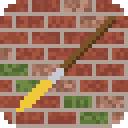
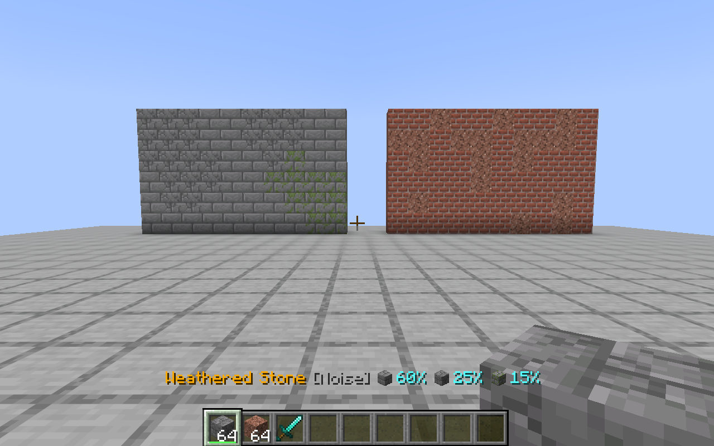
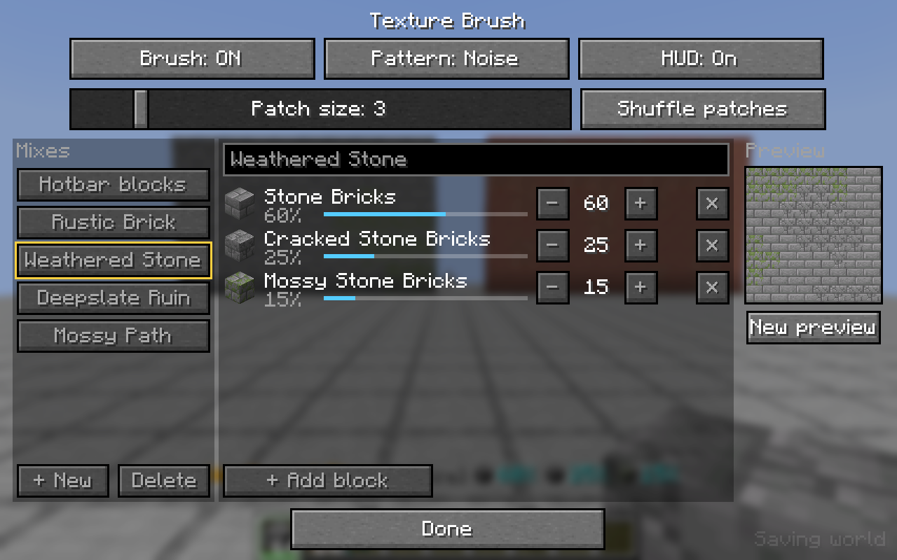
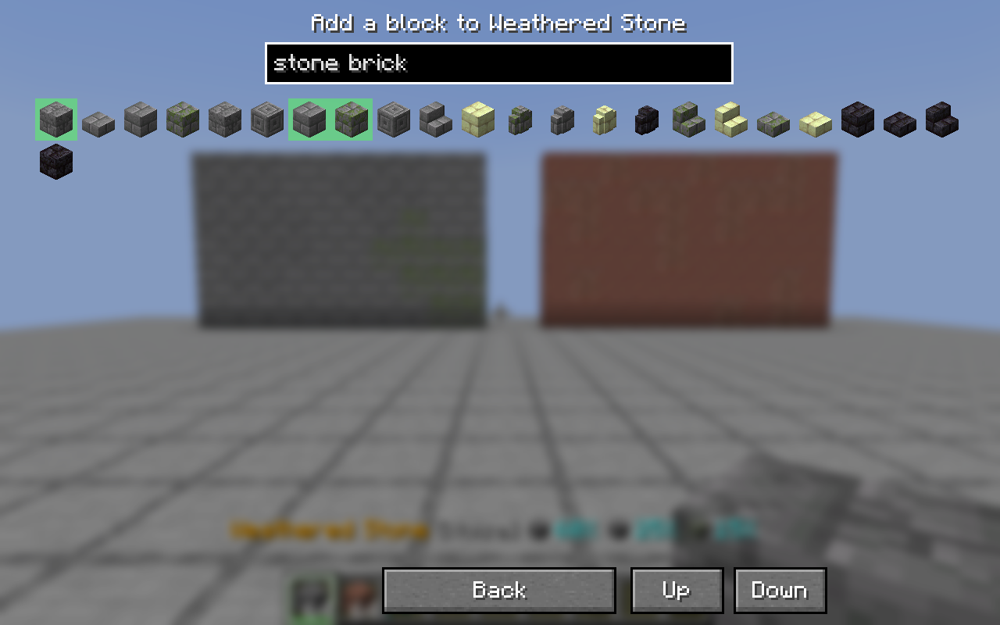
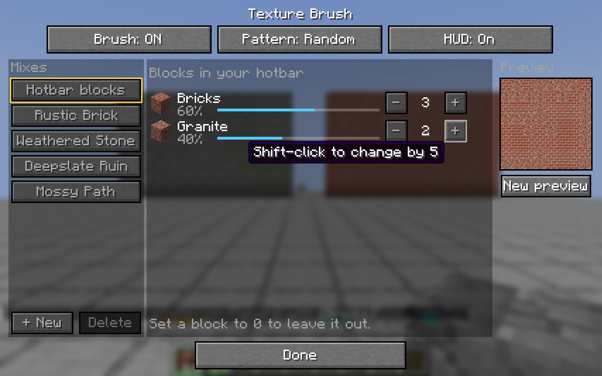

<p align="center">
  
</p>

<h1 align="center">Texture Brush</h1>

<p align="center">
  <b>Build with a mix of blocks without ever switching slots.</b><br>
  A client-side Minecraft mod for Fabric and NeoForge.
</p>

<p align="center">
  <a href="https://github.com/TomWhitticase/texture-brush/actions/workflows/build.yml"></a>
  
  
  
  <a href="LICENSE"></a>
</p>

<p align="center">
  
</p>

Walls made from a single block look flat. Mixing in a few other blocks fixes that, but placing them by hand means switching hotbar slots all the time. Texture Brush does the switching for you. Choose the blocks and how much of each you want, then build as normal. Every block you place is picked from your mix.

Both walls above were built by right-clicking with the brush turned on. Nothing was placed by hand.

## Features

- **Weighted mixes.** For example, bricks 3 and granite 1 gives about 75% bricks and 25% granite.
- **Four patterns:**
  - **Random** scatter.
  - **Noise**, natural-looking patches.
  - **Cycle**, an even repeating order.
  - **Checker**.
- **Saved mixes.** Four come built in (Rustic Brick, Weathered Stone, Deepslate Ruin, Mossy Path), and you can add your own.
- **An in-game editor.** Everything is point and click, so it works well with a trackpad. It has a live preview wall and a searchable block picker. *(Fabric)*
- **A status line above the hotbar.** It shows the active mix and each block's share.
- **Client-side only.** It works on vanilla and modded servers without being installed there.
- **Works in survival and creative.** In survival it uses the blocks you carry. In creative it can supply blocks from a saved mix even if they're not in your inventory.

## Install

1. Download the jar for your loader from [**Releases**](https://github.com/TomWhitticase/texture-brush/releases).
2. Put it in your instance's `mods/` folder. With CurseForge, that's *right-click the profile → Open Folder → mods*.
3. Launch the game.

| Loader | Minecraft | Jar | Also needs |
|---|---|---|---|
| Fabric | 26.3 | `texturebrush-fabric-<version>.jar` | [Fabric API](https://modrinth.com/mod/fabric-api). [Mod Menu](https://modrinth.com/mod/modmenu) is optional and adds a settings button. |
| NeoForge | 1.21.1 | `texturebrush-neoforge-<version>.jar` | Nothing |

## Quick start

1. Put the blocks you want to mix in your hotbar, for example bricks and granite.
2. Hold one of them and press **V** on Fabric or **G** on NeoForge. The status line above the hotbar shows the mix.
3. Build. Each placement picks a block for you.

To change the mix, press **B** to open the editor (Fabric).

## The brush editor (Fabric)

<p align="center">
  
</p>

| Area | What you can do |
|---|---|
| **Top row** | Turn the brush on or off, change the pattern, and show or hide the HUD. With **Noise** selected, you also get a patch-size slider and a **Shuffle patches** button. |
| **Mixes** (left) | Pick *Hotbar blocks* or a saved mix. The one you pick is what the brush uses. **+ New** saves the blocks in your hotbar as a new mix, and **Delete** asks you to confirm. |
| **Blocks** (middle) | Each block shows its share as a bar. Use **−** and **+** to change its weight (shift-click changes it by 5), and **✕** to remove it. Click the name at the top to rename the mix. |
| **Preview** (right) | Shows an 8×8 wall built with the current mix and pattern, and updates as you edit. **New preview** rolls a different example. |

<p align="center">
  
  
</p>

**+ Add block** opens a grid of every block, with the ones in your inventory first. Type to search, and click a block to add it. Blocks already in the mix are highlighted green.

In **hotbar mode** (right screenshot), the mix is whatever blocks are in your hotbar. Setting a block's weight to 0 leaves it out.

## Patterns

| Pattern | What you get | Good for |
|---|---|---|
| **Random** | A fresh weighted pick for every block | General variety |
| **Noise** | Patches of each block that still match your ratios. The same spot always gives the same block. | Moss, weathering, ore-like veins, and patching a wall later |
| **Cycle** | An evenly spread repeating order, e.g. 3:1 gives A A B A A A B A | Regular trims and stripes |
| **Checker** | Alternates by position and ignores weights | Checkerboard floors |

## Controls

All of these can be rebound under **Options → Controls → Key Binds → Texture Brush**.

| Action | Fabric | NeoForge |
|---|---|---|
| Turn the brush on or off | `V` | `G` |
| Open the brush editor | `B` | Mods → Texture Brush → Config |
| Next pattern | `Y` | `Alt+P` |
| Next saved mix (or back to hotbar) | `N` | `Alt+L` |
| Add or remove the held slot from the hotbar mix | `U` | `Alt+G` |

The Fabric keys are different because Minecraft 26.3 uses `G` for Quick Actions, and its key bindings don't support Alt combinations.

## How it works

Just before you place a block, the brush picks one from your mix and selects that hotbar slot. Minecraft then places it as normal. If the block isn't in your hotbar, the brush swaps it in from your inventory, or in creative mode creates it. Only actions a player could do by hand are sent to the server: changing slots and moving items in your own inventory. That's why nothing needs installing on the server.

The brush only steps in when you're holding a block from the active mix. Other items and blocks work as usual.

## FAQ

**Does the server need the mod?**
No. It's client-only, and does nothing if installed on a server.

**Can it get me kicked?**
On normal servers, no. Very strict anti-cheat plugins on some public servers might flag fast slot switching, so check the server's rules first.

**What happens when I run out of a block in survival?**
That block drops out of the mix until you have more. The status line shows what's still available.

**Can I mix stairs, slabs or walls?**
Yes. The brush places whichever item it picks, so keep every block in the mix the same shape (for example, all stairs).

**Where are the settings stored?**
In `config/texturebrush.json` on Fabric and `config/texturebrush-client.toml` on NeoForge.

## Building from source

The repo has two independent Gradle builds that share the pattern logic in `common/`:

```
common/     pattern logic and unit tests, shared by both builds
fabric/     Fabric 26.3: editor, HUD, client game test
neoforge/   NeoForge 1.21.1
docs/       README images
```

```sh
cd fabric   && ./gradlew build   # needs JDK 25 to run Gradle; jar in fabric/build/libs/
cd neoforge && ./gradlew build   # needs JDK 21; jar in neoforge/build/libs/
./gradlew runClient              # start a dev client with the mod loaded (either folder)
```

### Tests

- `./gradlew test` (either folder) runs unit tests for the patterns. They check ratios, cycle order, noise stability and checker layout.
- `cd fabric && ./gradlew runClientGameTest` starts a real Minecraft client and:
  - builds both walls in the screenshot above by right-clicking, and checks that the blocks were mixed;
  - switches mixes and patterns with the in-game keys;
  - clicks **+** in the editor and checks the weight changed;
  - checks that settings files from 1.0.0 still load;
  - saves screenshots to `fabric/build/run/clientGameTest/screenshots/`, which is where the images in this README come from.

## License

[MIT](LICENSE) © Tom Whitticase
